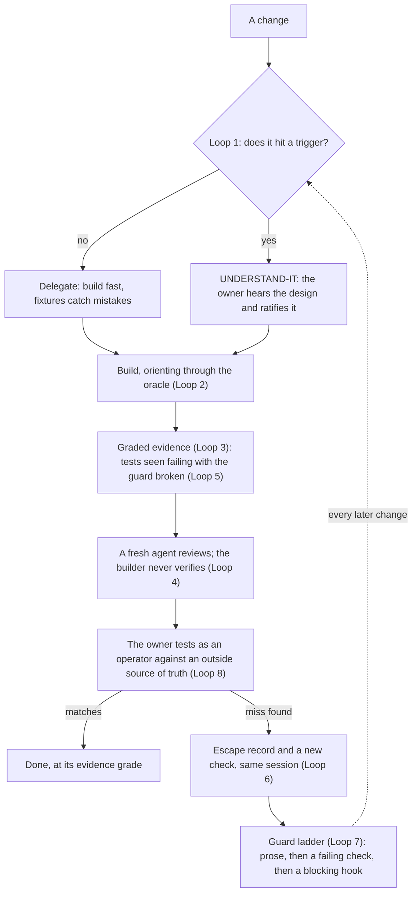

# Falcon

A Claude Code harness for careful projects: codebases where a **silent** bug is expensive, the kind
that passes its own tests and is wrong anyway.

That covers money (payments, ledgers, billing), health (dosing, records), security (auth,
permissions), data (pipelines, migrations, analytics people decide on), infrastructure (deploys,
deletes), and anything audited or regulated.

Falcon's case studies are about money. The mechanism isn't. It assumes you already use general practices (spec, plan,
test-first, worktrees, code review) and adds what those don't catch:

1. **Risk-tiered ownership.** Work is tiered by what a silent bug would corrupt, not by how hard it
   looks. Critical code is UNDERSTAND-IT: the human hears the design one concept at a time and ratifies
   it. You pick the triggers for your domain.
2. **Graded evidence, independent review.** Nothing is "done". The builder never verifies its own work,
   and a test only counts once it's been seen failing with its guard broken.
3. **Misses become checks.** Every miss a human catches becomes an escape record plus an enforced check
   in the same session, not a note.
4. **A guard ladder.** Rules that get broken move from prose to failing checks to hooks that block.



State lives in the repo, not the chat (Loop 9), so all of this survives `/clear`.

Read [`METHOD.md`](METHOD.md) for the loops, and [`examples/case-studies/`](examples/case-studies/) for six
real misses that produced checks.

## Results so far

| | |
|---|---|
| Escapes: misses a human caught after every automated layer passed | **20**, each shipped a new check the same session |
| Mistake classes logged, each with the guard that stops it | **27** |
| Classes that recurred after a guard existed | **2**, and both are the guard ladder at work |

The two recurrences:
- **A lock keyed at a different grain than the id it protects.** The first guard was a prose rule.
  The mistake came back, and the rule became a check.
- **A fix applied to one of two parallel paths.** The first check pinned twin *functions*. The mistake
  came back one layer up, on a twin *entry point* (a money effect added to the scheduled job but not the
  webhook), and the check was widened to cover entry points.

No other class has a recorded recurrence after its guard landed.

## Where Falcon fits

Falcon runs **on top of** a general workflow harness, not instead of one.

| | What it gives you | What happens to a miss |
|---|---|---|
| [Superpowers](https://github.com/obra/superpowers) | A mandatory workflow: brainstorm, plan, TDD, subagent execution, code review | Not recorded |
| [Compound Engineering](https://github.com/EveryInc/compound-engineering-plugin) | Plan, work, review, then **compound**: learnings written to `docs/solutions/` for later plans to read | Becomes a **note** |
| [Spec Kit](https://github.com/github/spec-kit) | Spec-driven development: constitution, specify, plan, tasks, implement | Not recorded |
| **Falcon** | What those don't check: whether the code is right about the thing that matters, when its own tests pass | Becomes a **check that fails**, the same session |

Keep the workflow harness you use. Falcon adds:
- tiers set by what a silent bug would cost, where the owner must *understand* critical code, not just approve it;
- graded evidence, where a test counts only once it has been seen failing with its guard broken;
- an enforced check for every miss a human catches, plus a guard ladder that escalates rules that keep breaking;
- operator sessions compared against a source of truth outside the system.

**Why Falcon copies files instead of installing as a plugin:** its tiers, escapes, mistake log, and checks
are project state. They have to live in the repo, so they get reviewed, versioned, and inherited by the
next contributor (Loop 9). The `falcon-init` skill is the only part that lives outside the repo, and all
it does is copy those files in.

## Pick your triggers

The UNDERSTAND-IT tier is a set of *triggers*: kinds of change where a silent bug corrupts something
that matters. Five categories cover most careful projects:

| Trigger | Money platform | Health | Auth / security | Data pipeline | Infra |
|---|---|---|---|---|---|
| **Critical computation** | ledger splits, interest | dosage, risk scores | — | metrics people decide on | capacity limits |
| **Identity** | customer dedup keys | patient record matching | user/tenant resolution | join and dedup keys | resource naming |
| **Integrity / trust** | audit hash chain | consent and access log | permission checks, token validation | lineage, schema contracts | IAM policy |
| **Exactly-once / determinism** | pay once on retry | order once | session revocation | idempotent loads, reproducible runs | idempotent apply |
| **Irreversible actions** | send money | notify a patient | delete an account | drop a table | destroy a resource |

Write yours into the tier table in `CLAUDE.md` and the paths into `.claude/protected_paths.txt`.

## What's in the box

```
template/                         → copied into your repo by install.sh
  CLAUDE.md                       working agreement: ownership tiers, review layer, guidelines
  NEXT-START-HERE.md, NEXT.md     session handoff + never-lossy to-do
  INVARIANTS.md, ARCHITECTURE.md  the law and the map
  docs/working_rules.md           W1–W12 process rules
  docs/mistakes.md                recurring-mistake log (seeded with 8 common classes)
  docs/adr/                       decision records
  .claude/settings.json           wires the hooks
  .claude/hooks/                  protect_paths · no_stash_while_live · next_md_size
  .claude/protected_paths.txt     the delegation fence's path list
  .claude/agents/oracle.md        read-only codebase oracle
  .claude/skills/falcon-setup/    first-run interview: you choose UNDERSTAND-IT vs Delegate → ADR-0001
  .claude/skills/review-harness/  init · review · sweep · escape
  review/                         GATES · SCENARIOS · HAZARDS · verify.py · falcon.toml
  review/OPERATOR_SESSION.md      Loop 8: test as an operator, diff totals against the source of truth
skills/falcon-init/               → copy to ~/.claude/skills/ once; "set up falcon" installs + interviews
examples/case-studies/            sanitized escapes
tests/                            tests for verify.py and the hooks
```

## Install

**Once per machine:** clone Falcon and add the `falcon-init` skill to Claude Code.

```bash
git clone https://github.com/habibafaisal/falcon.git ~/falcon
mkdir -p ~/.claude/skills && cp -r ~/falcon/skills/falcon-init ~/.claude/skills/
```

**Per project:** open Claude Code in the repo and say **"set up falcon"**. `falcon-init` runs the installer,
then starts the setup interview. (Cloned somewhere other than `~/falcon`? Set `FALCON_HOME`.)

Without the skill, run the installer yourself:

```bash
~/falcon/install.sh /path/to/your/repo     # never overwrites; lists files to merge by hand
```

Then open Claude Code in the repo. It sees the unfinished `CLAUDE.md` and runs the `falcon-setup`
interview. You decide what is UNDERSTAND-IT and what is Delegate, in one of two modes: name your own
triggers from scratch, or strike out the defaults (every row you keep needs a reason). Your choices are
recorded in `docs/adr/0001-ownership-tiers.md`, and you can redo them any time.

Or set it up by hand:
1. Fill in `CLAUDE.md` and adapt the ownership table to your domain.
2. List your UNDERSTAND-IT paths in `.claude/protected_paths.txt`, each with what a delegate could
   silently break there.
3. Set `source_dir` and `test_command` in `review/falcon.toml`, and name your source of truth in
   `review/GATES.md`.
4. `pip install pyyaml` (plus `tomli` on Python < 3.11).

## Daily use

| When | Do |
|---|---|
| Orienting | Ask the `oracle` agent before reading files |
| Before UNDERSTAND-IT work | Walk the design with the owner and record an ADR |
| After building | `python review/verify.py <slug>`, then "review this capability" (fresh agent) |
| Before promoting a capability | "sweep <slug>": prove the tests go red under mutation |
| Owner catches a miss | "record an escape", then add the new check in the same session |
| End of session | Rewrite `NEXT-START-HERE.md` and update `NEXT.md` |

## Develop

```bash
uv run --with pytest --with pyyaml pytest
```
